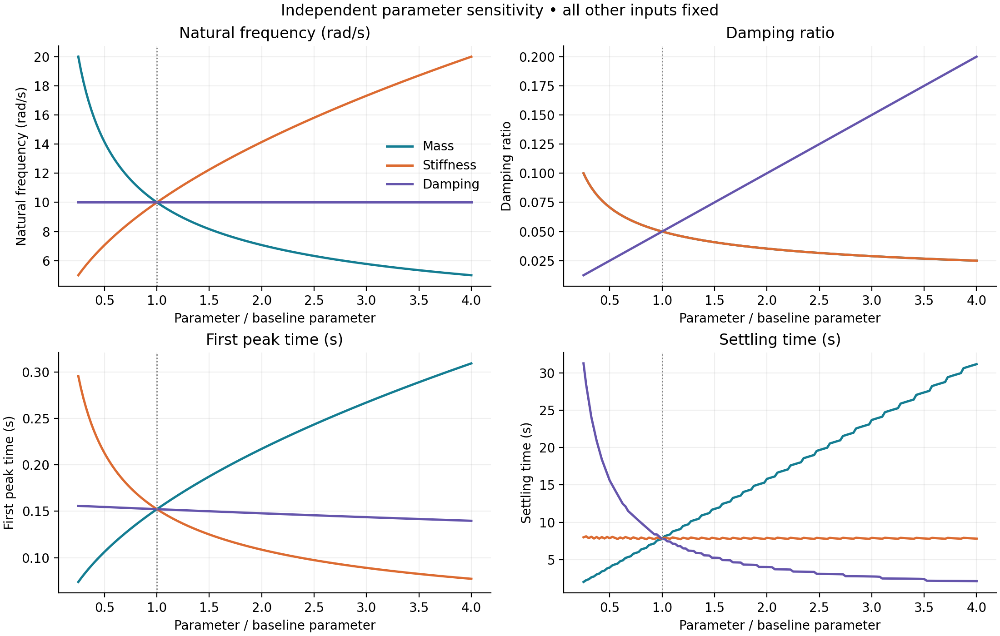

# SDOF Free-Vibration Sensitivity Lab

A reproducible civil engineering project investigating independent changes in mass, stiffness and viscous damping. Includes a Streamlit dashboard, analytical solver, six sensitivity/response figures, a printable report, 453-case dataset and automated checks.

## Run locally

```bash
python -m venv .venv
source .venv/bin/activate   # Windows: .venv\Scripts\activate
pip install -r requirements.txt
python -m streamlit run app.py
```

## Reproduce the submission

```bash
python run_study.py
python -m unittest discover -s tests -v
python -m unittest discover -s tests -p app_smoke.py -v
# Optional: rebuild the PDF
pip install -r requirements-report.txt
python build_report.py
```

- [Printable study report](reports/SDOF_Sensitivity_Report.pdf)
- [Engineering interpretation and derivations](reports/engineering_interpretation.md)
- [All computed cases](reports/sensitivity_data.csv)
- [Local dimensionless sensitivities](reports/local_sensitivity.csv)
- [Numerical solver](sdof.py), [study runner](run_study.py), [Streamlit app](app.py)




## Interactive laboratory v2.0

The deployed launch path remains `streamlit.py`. Changes committed on `main` are picked up by the connected Streamlit app.

- Editable m, k and either viscous coefficient c or damping ratio zeta; the other damping quantity is derived for the baseline.
- Signed initial displacement and velocity, including a system at rest and undamped motion.
- Adjustable settling tolerance, independent factor interval, case count and plotting duration; every committed widget change reruns the active view.
- Results: natural and damped frequencies, period, critical damping, decay rate, first future peak, global amplitude, final settling, initial energy; x/v/a histories, energy exchange and phase plane.
- Sensitivity: raw/normalized curves, local elasticity and dynamically calculated influence ranking for the selected interval.
- Comparison: displacement, velocity or acceleration for the lower, baseline and upper factors.
- On-site concepts: force balance, characteristic roots, general initial-condition solutions in every damping regime, peak/settling definitions, energy balance, sensitivity derivation and current numerical substitution.
- Current-study CSV, strict JSON and Markdown exports; PNG downloads for every graph.

**Definitions and edge cases:** global amplitude includes t=0, while first future peak excludes it. A negative displacement extremum counts as a peak in absolute displacement. Monotonic responses have no future peak (N/A). Nonzero undamped motion never settles; zero initial state remains at rest and settles at t=0. Undefined relative normalizations and derivatives are N/A. The reference PDF and original CSV files remain the reproducible original default submission; live exports reflect the current controls.

**Limits:** baseline m=100..100000 kg, k=1000..10000000 N/m, c=0..100000 N s/m in coefficient mode, zeta=0..3 in ratio mode (c is derived), x0=-0.5..0.5 m, v0=-5..5 m/s, tolerance=0.1..10%, factors=0.1..4. The factor sweep can extend properties beyond their baseline input limits; it remains a positive-mass, positive-stiffness linear model. Factor 1 is always included. Multiplicative variation cannot change c=0. Plot duration is bounded to 3600 s and shortened if required to retain at least 80 points per oscillation within 20001 points; this never truncates analytical event metrics. Exports identify their actual chart interval.

## Default experiment

m=1000 kg, k=100000 N/m, c=1000 N s/m, x(0)=0 m, v(0)=0.1 m/s. Vary one property at a time by factors 0.25-4.0 (151 cases each). Natural frequency=1.59155 Hz, damping ratio=0.05, first peak=0.152268 s, settling=7.753210 s.

Settling means final entry into +/-2% of **each case's own peak**, not first entry. An analytical extremum search plus root solve avoids finite-window truncation. The solver supports all damping regimes and reports infinite settling for undamped motion. The 2% engineering approximation is 4/(zeta omega_n)=8m/c, not 4m/c. See the report for regime-dependent interpretations and the limitations of local settling derivatives.

## Deploy on Streamlit Community Cloud

1. Sign in at https://share.streamlit.io with your authorized account.
2. Select **Create app**, then **Deploy a public app from GitHub**.
3. Repository: `Ahmdullah16/Dynamics-Proejct`.
4. Branch: `main`. Main file path: `app.py`.
5. Choose Python **3.11** in advanced settings and deploy.

No API tokens or secrets are needed by the app. Dependencies are declared in `requirements.txt`; theme settings are in `.streamlit/config.toml`. Streamlit account authentication and any required terms acceptance must be completed by the account holder. A live app URL is only recorded after hosting is confirmed.

## Project structure

```text
app.py                 Interactive dashboard and exports
sdof.py                Governing equations, event metrics, OFAT study
plots.py               Shared plot functions
run_study.py           Reproduce figures and tables
build_report.py        Reproduce printable report (optional dependencies)
reports/               Report, CSV data, PNG and SVG figures
tests/                 Physics verification and Streamlit smoke test
.github/workflows/     Continuous integration
```

This illustrative linear SDOF model is not a calibrated building model or a safety assessment.
